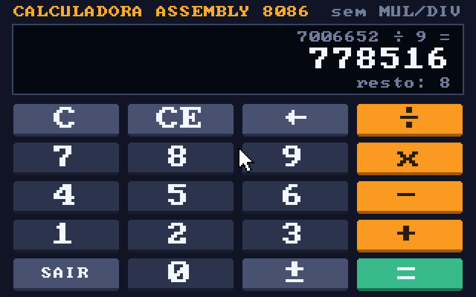

# Calculadora-Assembly

Calculadora em Assembly 8086 (DOS) que realiza **Adição, Subtração, Multiplicação e Divisão** —
com o desafio original mantido: **nenhuma instrução `MUL`, `IMUL`, `DIV` ou `IDIV`** em todo o código.

São duas versões que compartilham as mesmas rotinas aritméticas:

| Arquivo | O que é |
|---|---|
| `Calculadora.asm` | Versão em modo texto (menu, como no projeto original) |
| `CalcGUI.asm` | Versão com **interface gráfica** VGA 320x200, botões clicáveis com o mouse e atalhos de teclado |
| `aritmet.inc` | Soma, subtração, multiplicação e divisão de 32 bits sem MUL/DIV + conversão texto ↔ número |
| `fonte8x8.inc` | Fonte 8x8 embutida usada pela interface gráfica (domínio público) |
| `bin/` | `CALC.EXE` e `CALCGUI.EXE` já montados, prontos para rodar no DOSBox |
| `testes/` | Testes automáticos (emulador 8086 em Python) |



## Como rodar

1. Instale o [DOSBox](https://www.dosbox.com/) (ou DOSBox-X).
2. No DOSBox, monte a pasta do projeto e rode:
   ```
   mount c C:\caminho\para\Calculadora-Assembly
   c:
   cd bin
   CALCGUI       (interface grafica)
   CALC          (modo texto)
   ```

### Controles da interface gráfica
| Ação | Mouse | Teclado |
|---|---|---|
| Dígitos | 0–9 | 0–9 |
| Operações | ÷ x − + | `/` `*` ou `x` `-` `+` |
| Resultado | = | `ENTER` ou `=` |
| Apagar último dígito | ← | `BACKSPACE` |
| Limpar número (CE) / tudo (C) | CE / C | `E` ou `DELETE` / `C` |
| Trocar o sinal | ± | `N` |
| Sair | SAIR | `ESC` |

As contas podem ser encadeadas (`12 + 30 x 2 = 84`, da esquerda para a direita), a divisão
mostra quociente **e resto**, e erros (divisão por zero, estouro) aparecem no visor.

### Modo texto
Escolha a operação (1–5), digite os números e confirme com `ENTER`. `BACKSPACE` apaga,
`ESC` volta ao menu e teclas inválidas apenas apitam.

## Montando a partir do código

Os dois programas usam sintaxe MASM e só instruções do 8086. Deixe `aritmet.inc` e
`fonte8x8.inc` na mesma pasta.

```
jwasm -mz Calculadora.asm          (JWasm / UASM, gera o .EXE direto)
jwasm -mz CalcGUI.asm

masm Calculadora.asm;  link Calculadora.obj;     (MASM + LINK no DOS)
tasm CalcGUI.asm       tlink CalcGUI.obj         (TASM)
```
Tudo foi testado com JWasm + DOSBox. A versão em modo texto usa só serviços básicos do DOS
e deve abrir também no EMU8086; a gráfica precisa de VGA e mouse, então use o DOSBox.

## Como fazer contas sem MUL e sem DIV

Todos os números são inteiros de **32 bits com sinal** (−2.147.483.648 a 2.147.483.647).
Como o 8086 só tem registradores de 16 bits, cada número ocupa um par (`DX:AX` e `CX:BX`).

- **Multiplicação — “desloca e soma”**: para cada bit 1 do multiplicador, soma o multiplicando
  (deslocado para a esquerda) ao produto. É a multiplicação do papel, em binário.
- **Divisão — divisão com restauração**: 32 passos; em cada um, o próximo bit do dividendo entra
  no resto e, se o resto for maior ou igual ao divisor, subtrai e o bit do quociente vira 1.
  Quociente truncado em direção ao zero e resto com o sinal do dividendo (igual ao C):
  `-7 ÷ 2 = -3, resto -1`.
- **Texto → número**: `n * 10 = (n << 3) + (n << 1)`.
- **Número → texto**: cada dígito é quantas vezes dá para subtrair 10⁹, 10⁸, … , 1.
- **Endereço do pixel na tela gráfica**: `y * 320 = (y << 8) + (y << 6)`.

Estouro em qualquer operação (inclusive `-2147483648 ÷ -1`) é detectado e avisado.

## O que foi corrigido em relação à versão original

- A adição e a impressão da multiplicação usavam **`DIV`** para converter o resultado em
  decimal — quebrando o próprio desafio. Agora nenhuma conta usa `MUL`/`DIV`.
- `SHL bh,4` / `SHR al,5` não são instruções do 8086 (só existem a partir do 80186); o código
  original não montava no MASM/TASM, só no EMU8086.
- Faltava `.STACK`: o programa rodava com a pilha por cima de memória não reservada.
- Só aceitava números de um dígito (0–9); agora aceita qualquer inteiro de 32 bits, negativos
  inclusive.
- A divisão tinha um caso especial “remendado” para o divisor 9 (estouro de 8 bits) e usava
  comparações com sinal (`JG`/`JL`) em valores sem sinal.
- Resultados saíam com zero à esquerda (`Resultado: 05`).
- Teclas inválidas continuavam aparecendo na tela; agora são ignoradas com um bipe.
- As quebras de linha usavam só `LF` (10), o que gera texto “em escada” no DOS real e no
  DOSBox; agora é `CR LF`.
- Só o `s` minúsculo continuava o programa; agora `S` também. Teclas especiais (setas, F1…)
  não são mais confundidas com letras.
- Divisão por zero agora mostra uma mensagem clara e pede outro divisor.

## Testes

Os testes rodam os `.EXE` de verdade num emulador 8086 (Unicorn) com DOS/BIOS simulados,
conferem os resultados com Python e **acusam qualquer `MUL`/`DIV` executado**:

```
pip install unicorn pillow
python3 testes/testa_texto.py     # ~5000 contas no modo texto, incluindo os limites de 32 bits
python3 testes/testa_gui.py       # cliques nos botoes + 300 contas encadeadas lidas do visor
```

---
Feito por: Jean Okabe Rezende Piton || Matheus Zanon Caritá
